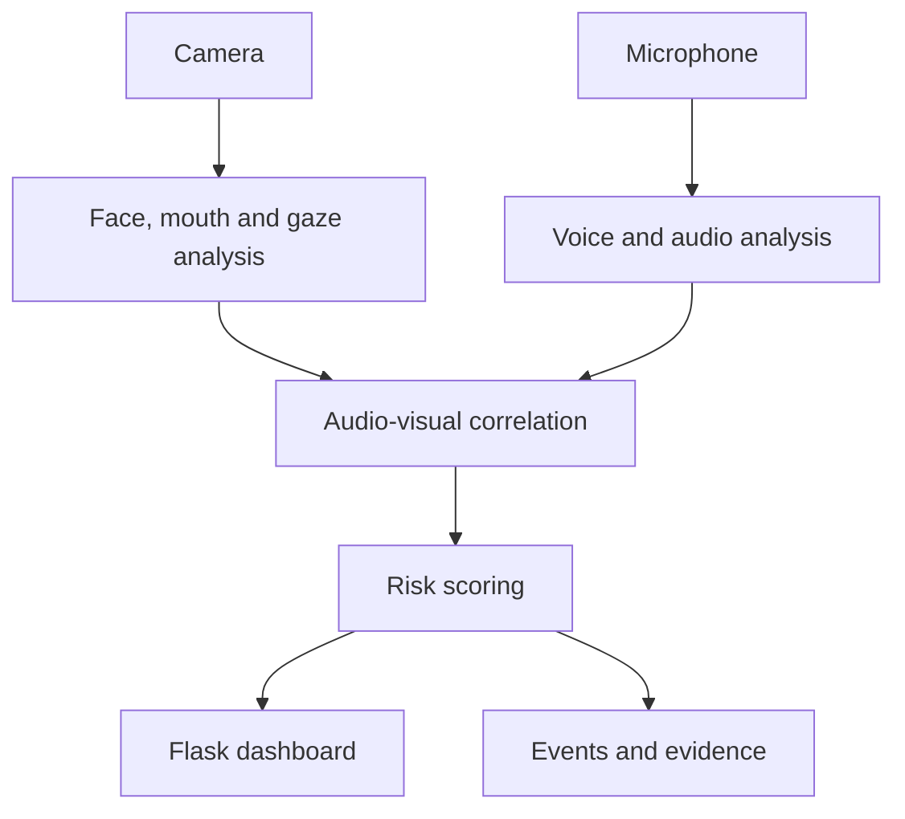

# ProctorAI (ProctorGuard Voice + LipSync + Gaze)

Research prototype for an exam proctoring pipeline that combines:
- real-time voice biometrics,
- lip-sync verification,
- gaze tracking with per-user calibration,
- risk scoring and evidence logging.

The repository includes two runnable tracks:
- `web_modules` stack: Flask app for enrollment + monitoring dashboard.
- `main_pipeline.py` / `chunks_modules`: direct CV/audio pipelines for desktop/live processing.

---

[Overview](#1-what-this-system-does) · [Architecture](#2-high-level-architecture) · [Setup](#9-setup-and-run) · [API](#7-api-endpoints-flask) · [Contributing](CONTRIBUTING.md) · [Security](SECURITY.md) · [License](LICENSE)

## 1. What This System Does

At runtime, the system continuously evaluates:
- **Who is speaking** (speaker verification against enrolled profile),
- **Whether speech matches visible mouth motion** (AV correlation + audio-sync heuristics),
- **Whether gaze stays in calibrated region** (4D gaze + head-pose model),
- **Whether cheating risk is escalating** (rule/event-based risk engine).

When anomalies are detected, it writes:
- frame evidence to `proctor_logs/frames/`,
- audio evidence to `proctor_logs/audio/`,
- structured event timeline to `proctor_logs/events.json`.

---

## 2. High-Level Architecture



---

## 3. Core Methodologies

### 3.1 LipSync / AV Correlation
- **MAR-based mouth motion** from facial landmarks (`13,14,78,308`).
- **Heuristic AV state machine** (`SYNC_OK`, `AUDIO_ONLY`, `SILENT_SPEECH`, `WEAK_SYNC`, `IDLE`) using MAR delta + audio energy correlation.
- **AudioSync verifier** adds:
  - rolling energy-motion correlation,
  - onset delay (`AV_DESYNC`),
  - whisper signal,
  - coarse phoneme-viseme mismatch,
  - playback suspicion from repeated spectra.
- **Escalation verifier** (`LipSyncVerifier`) runs on suspicious streaks and computes segment-level score (default threshold `0.45`).

### 3.2 Gaze Detection
- External OpenVINO pipeline extracts **`dx, dy, yaw, pitch`** features.
- Per-user interactive calibration: `CENTER`, `LEFT`, `RIGHT`, `TOP`, `BOTTOM`.
- Detection uses:
  - 4D Mahalanobis distance vs calibrated mean/covariance,
  - geometric horizontal/vertical thresholds,
  - temporal smoothing + hysteresis,
  - adaptive baseline drift.
- Runtime emits `INSIDE`, `OUTSIDE`, `NO_FACE`, `CALIBRATING`, etc.

### 3.3 Speaker Verification
- Enrollment builds per-user embedding profile from 10 prompted answers.
- Runtime computes similarity and drift from rolling windows.
- Decision states: `MATCH`, `VIOLATION` with reasons like `different_speaker_detected` or `voice_drift_detected`.

---

## 4. Repository Structure

```text
.
├─ web_modules/                 # Web API + monitoring worker + gaze bridge
├─ chunks_modules/              # Chunk/live CV processing utilities
├─ ProctorGuardAI-master/       # OpenVINO gaze reference implementation
├─ templates/                   # Flask HTML templates
├─ sql/                         # SQL schema
├─ main_pipeline.py             # Standalone desktop pipeline
├─ web_enrollment_app.py        # Flask app entrypoint
├─ config.yaml                  # Main runtime config
├─ requirement.txt              # Dependencies
└─ proctorguard.db              # SQLite datastore
```

---

## 5. Full Module Reference

### Root modules
- `main_pipeline.py`: standalone end-to-end proctoring pipeline (camera+mic+overlay+risk logging).
- `audio_sync_verification.py`: explainable audio-sync heuristic engine and flags.
- `av_correlation.py`: lightweight MAR/audio correlation status engine.
- `lip_sync_verification.py`: segment-level lip-sync verification layer.
- `speaker_verification.py`: runtime speaker identity + drift verification.
- `voice_features.py`: preprocessing + feature extraction (MFCC, deltas, pitch, energy embeddings).
- `voice_enrollment.py`: 10-question enrollment processing and profile building.
- `voice_biometric_store.py`: SQLite persistence for users, samples, profiles, runtime matches, gaze calibration.
- `risk_engine.py`: event weight model, risk accumulation, frame/audio evidence persistence.
- `enrollment_questions.py`: canonical enrollment question bank (Q01–Q10).
- `web_enrollment_app.py`: minimal Flask launcher (`create_app()`).
- `_migrate_gaze_table.py`: one-time helper to ensure `gaze_calibrations` table exists.
- `chunks.py`: async entrypoint for `chunks_modules.app`.

### `web_modules/`
- `app.py`: Flask routes for enrollment, monitoring, frame stream, gaze calibration control.
- `monitoring.py`: threaded monitoring worker; orchestrates AV, speaker, gaze, escalation, state cache.
- `gaze_bridge.py`: adapter over external gaze module with per-user calibration lifecycle.
- `audio.py`: adaptive VAD microphone monitor.
- `enrollment.py`: WAV parsing/saving + enrollment API service wrapper.
- `verification_logic.py`: fusion logic (speaker count estimate, drift tracker, window decision fusion).
- `config.yaml`: web runtime config mirror.
- `__init__.py`: exports `create_app`.

### `chunks_modules/`
- `app.py`: non-web pipeline runner (`live_mode` overlay or batch chunk processing).
- `live_overlay.py`: real-time visual overlay pipeline with debug/normal UI modes.
- `batch_processing.py`: per-video-chunk processing and metric export (`raw_metrics.csv`).
- `shared.py`: reusable CV/audio helpers (MAR, optical flow, gating, overlay utilities, backends).
- `media.py`: audio extraction and pyannote VAD helpers.
- `config.py`: typed config constants loaded from `config.yaml`.
- `__init__.py`: package marker.

### `ProctorGuardAI-master/` (legacy/reference)
- `chunks.py`: OpenVINO gaze pipeline used by `web_modules.gaze_bridge`.
- `proctorguard_mahalanobis.py`: earlier hybrid gaze prototype.
- `evaluate.py`: offline evaluation tooling over `gaze_log.csv`.
- `README.md`: original reference docs.
- `intel/...`: OpenVINO IR model files (face, landmarks, head pose, gaze).

---

## 6. Data Model (SQLite)

Primary tables:
- `users`
- `enrollment_questions`
- `enrollment_samples`
- `speaker_profiles`
- `runtime_voice_matches`
- `gaze_calibrations`

Schema file: `sql/proctorguard_voice_schema.sql`

Default DB path:
- `proctorguard.db`

---

## 7. API Endpoints (Flask)

### UI pages
- `GET /` -> enrollment UI (`voice_enrollment.html`)
- `GET /monitor` -> monitoring UI (`monitoring.html`)

### Enrollment
- `GET /api/enrollment/questions?user_id=...`
- `GET /api/enrollment/status/<user_id>`
- `POST /api/enrollment/recording` (multipart WAV upload)
- `POST /api/enrollment/complete`
- `POST /api/enrollment/admin/reset/<user_id>`

### Monitoring
- `POST /api/monitor/start`
- `POST /api/monitor/stop`
- `GET /api/monitor/state`
- `GET /api/monitor/frame`
- `GET /api/monitor/stream` (MJPEG)

### Gaze calibration controls
- `GET /api/monitor/gaze`
- `POST /api/monitor/gaze/start-step`
- `POST /api/monitor/gaze/reset`

---

## 8. Configuration

Main config file: `config.yaml` (mirrored in `web_modules/config.yaml`).

Important keys:
- camera/audio: `camera_index`, `mic_sample_rate`, `mic_block_size`, `mic_threshold`
- lip-sync: `rule_mar_threshold`, `rule_mar_delta_threshold`, `corr_window_frames`, `corr_threshold`, `lipsync_verify_threshold`
- occlusion: `hand_mouth_iou_threshold`, `mouth_occlusion_coverage_threshold`
- speaker: `speaker_similarity_threshold`, `speaker_drift_threshold`, `speaker_window_seconds`
- policy: `audio_sync_low_score_threshold`, `suspicious_streak_for_verify`, `terminate_on_cheating_alert`

---

## 9. Setup and Run

### 9.1 Environment

Clone the repository first:

```bash
git clone https://github.com/tejas764/ProctorAI_1.git
cd ProctorAI_1
```

A camera, microphone, compatible Python environment, and the referenced OpenVINO models are required. Check dependency compatibility before selecting a Python version.

```powershell
python -m venv .venv
.\.venv\Scripts\Activate.ps1
pip install -U pip
pip install -r requirement.txt
```

### 9.2 Start Web App

```powershell
python web_enrollment_app.py
```

Open:
- `http://localhost:5000/` for enrollment
- `http://localhost:5000/monitor` for monitoring

### 9.3 Run Standalone Desktop Pipeline

```powershell
python main_pipeline.py
```

### 9.4 Run Chunk/Live Overlay Pipeline

```powershell
python chunks.py
```

---

## 10. Event & Risk Semantics

Examples of event reasons:
- `AUDIO_ONLY`
- `AUDIO_WITHOUT_LIP_MOTION`
- `PHONEME_VISEME_MISMATCH`
- `VOICE_MISMATCH`
- `VOICE_DRIFT`
- `MULTIPLE_FACES`
- `GAZE_OUTSIDE`
- `VOICE_POLICY_WARNING`
- `CHEATING_ALERT`
- `LIPSYNC_VERIFICATION_FAIL`

Each event contributes weighted delta to `risk_score`; levels are:
- `NORMAL`
- `WARNING`
- `CHEATING_LIKELY`

---

## 11. Evidence and Outputs

- `proctor_logs/events.json`: exported event timeline + score summary.
- `proctor_logs/frames/*.jpg`: frame snapshots for flagged events.
- `proctor_logs/audio/*.wav`: synchronized audio clips for flagged events.
- `proctor_data/enrollment_audio/<user_id>/`: stored enrollment recordings.

---

## 12. Notes on Dependencies

- `pyannote.audio` is optional for non-live batch mode and is pinned only for Python `< 3.13`.
- `openvino` is required for external gaze model path used by `gaze_bridge`.
- `sounddevice` is required for live microphone monitoring.
- On Windows, `pywin32` may be needed by legacy scripts.

---

## 13. Security/Operational Guidance

- Tune thresholds using your real exam environment (mic noise, webcam angle, lighting).
- Keep per-user gaze calibration mandatory before exam start.
- Reset enrollment only via admin endpoint and audit that action.
- Use HTTPS and authentication for deployment; current Flask setup is local-dev style.

---

## 14. Recommended Next Improvements

1. Replace fallback lip-sync verifier with SyncNet/Wav2Lip discriminator inference.
2. Add authenticated user/session tokens to all monitor APIs.
3. Add automated threshold calibration/validation scripts per environment.
4. Add unit/integration tests around risk escalation and event cooldown logic.
5. Containerize web service and separate DB/log storage for production.


## 15. Interpretation and project policies

Risk flags are heuristic review signals, not proof of cheating. Validate false positives across lighting, audio conditions, and individual users; decisions about students require human review. Use consented recordings and protect biometric data and evidence logs.

- [Contribution guide](CONTRIBUTING.md)
- [Security policy](SECURITY.md)
- [License terms](LICENSE)
